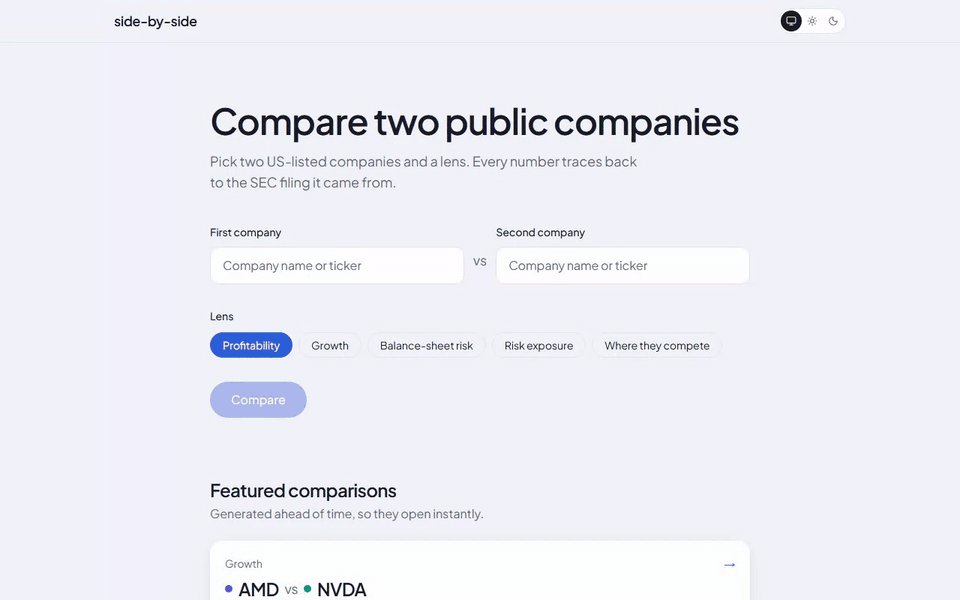
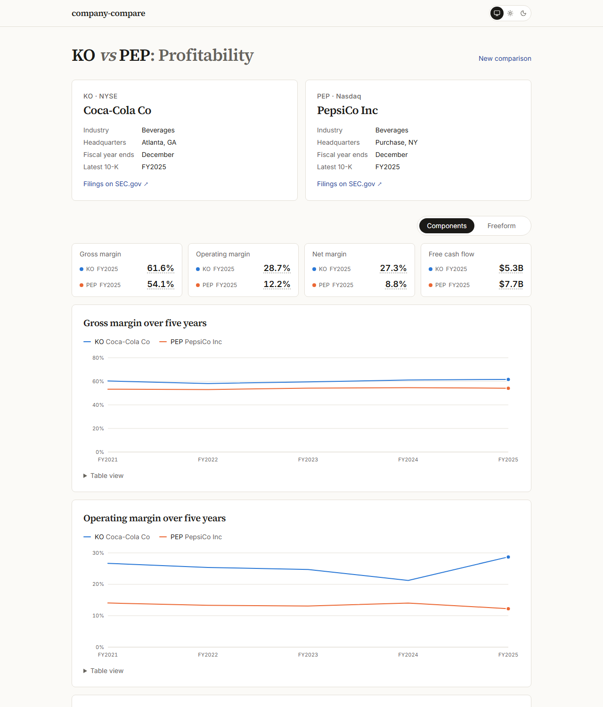
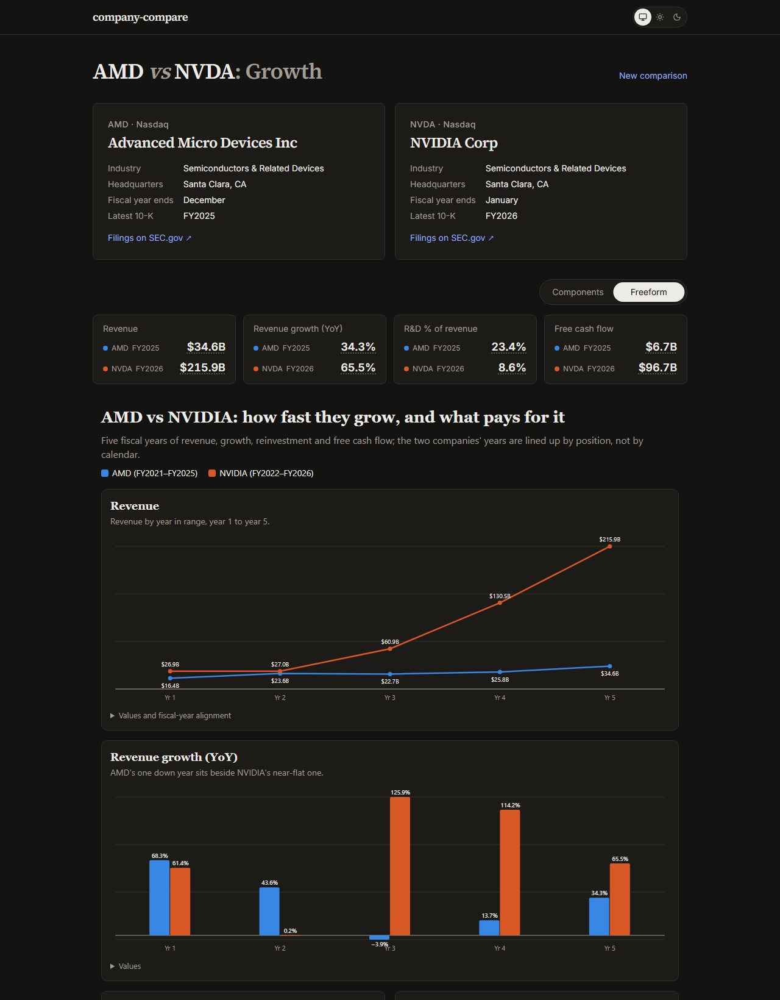
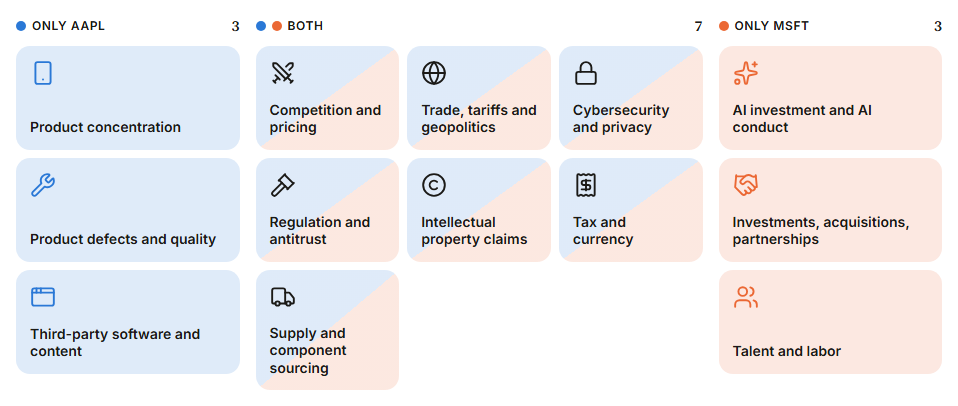
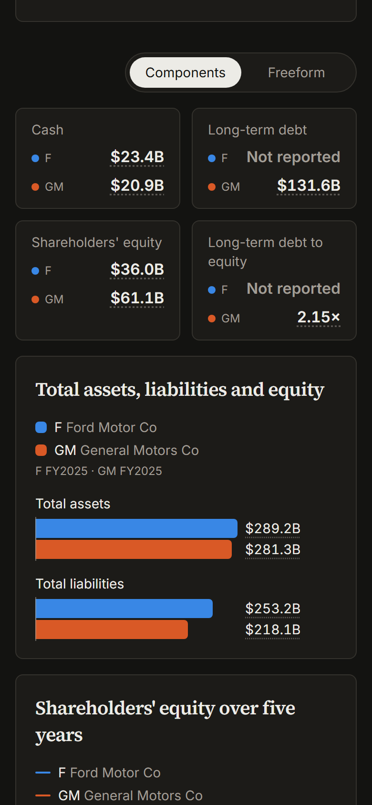
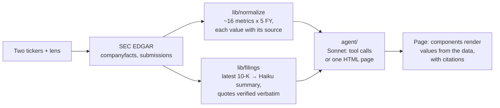

# company-compare

Pick two US public companies and a lens; Claude builds the comparison from their SEC filings. Every number on the
page links to the filing it came from.



- **Five lenses:** Profitability, Growth, Balance-sheet risk, Risk exposure, Where they compete.
- **Two modes.** *Components*: Claude composes the page from a fixed set of charts and cards through tool calls.
  *Freeform*: Claude writes a whole HTML page, shown in a sandboxed iframe.
- **Grounded.** Claude never writes a chart or card number: it names a metric and years, and the page looks the
  values up in the normalized filing data. Hover or tap any number for its filing (form, fiscal year, filed date)
  and a link to it on SEC.gov.
- **Neutral.** Takeaways describe differences, never a winner. Not financial advice.

| Components | Freeform |
|---|---|
|  |  |

| Risk exposure: each 10-K's risk factors, grouped | Phone, dark |
|---|---|
|  |  |

## How it works



| Folder | What it does |
|---|---|
| `lib/sec` | SEC client: ticker search, company facts, submissions, filing text. Server only. |
| `lib/normalize` | XBRL facts → revenue, margins, cash flow, debt… for the last five fiscal years, with fallback tags. Ratios are derived in code, never by the model; a missing metric is `not reported`, never 0. |
| `lib/filings` | The latest 10-K, condensed once per filing by Claude Haiku 5.5 (business, themed risks with quotes). Every quote is checked against the filing text. |
| `lib/cache` | One interface: a local `.cache/` folder, or Upstash Redis when deployed. |
| `agent/` | Lens + mode + data → components or an HTML page. No Next.js imports. [Its README](agent/README.md). |
| `evals/` | Code checks on real output: every number in prose appears in the data, no `not reported` shown as a value, valid components, self-contained freeform pages. |
| `featured/` | Five comparisons generated ahead of time and committed, so they open with no Claude or SEC calls. |
| `app/` | Next.js App Router: pages, the streaming `/api/compare` route, sign-in. |

A new comparison streams: progress steps, then a headline strip drawn in code (~1s), then each component as
Claude shows it. Results are cached per pair, lens and mode.

## Run it locally

Needs Node 24 and two values: an Anthropic API key and a User-Agent the SEC accepts (your name and email).

```sh
npm ci
cp .env.example .env.local   # set ANTHROPIC_API_KEY and SEC_USER_AGENT
npm run dev                  # http://localhost:3000
```

Locally there is no sign-in and no limit. Featured comparisons cost nothing; a new one runs Claude Sonnet 5.5 on
your key, plus Claude Haiku 5.5 once per 10-K the first time a text lens reads it.

| Command | |
|---|---|
| `npm run lint && npm run typecheck && npm test` | What CI runs. Never calls Claude or the SEC. |
| `npm run eval -- [--model sonnet\|opus] [--only <case>]` | Generates the eval cases and scores them (`evals/out/`). Calls Claude. |
| `npm run featured -- [--only <case>]` | Regenerates featured comparisons, keeping only runs that pass every check. Review each page by eye before committing it. |
| `npm run eval:fixtures` | Rebuilds the eval fixtures from the SEC. |

## Deploy

The live site adds Google sign-in for generating (viewing saved and featured comparisons stays open), 5 new
comparisons per account per day, and a monthly budget tracked as actual token spend.

1. **Anthropic:** in the Console, create a workspace for this app, set its monthly spend limit a little above your
   budget (e.g. $6 for $5), and create an API key in it.
2. **Upstash:** create a Redis database; copy its REST URL and token.
3. **Google:** in Google Cloud → APIs & Services, set up the OAuth consent screen (email and profile scopes) and
   create an OAuth client ID of type *Web application* with the redirect URI
   `https://<your-domain>/api/auth/callback/google`.
4. **Vercel:** import the repo, set the variables below, deploy. Generation routes run up to 300 seconds.

| Variable | Needed | Purpose |
|---|---|---|
| `ANTHROPIC_API_KEY` | always | The workspace key from step 1 |
| `SEC_USER_AGENT` | always | e.g. `company-compare jane@example.com` |
| `REQUIRE_SIGN_IN` | deployed | `true`: sign-in, limits, spend tracking and logs |
| `AUTH_SECRET` | with sign-in | Random secret, e.g. `openssl rand -base64 33` |
| `AUTH_GOOGLE_ID`, `AUTH_GOOGLE_SECRET` | with sign-in | The OAuth client from step 3 |
| `UPSTASH_REDIS_REST_URL`, `UPSTASH_REDIS_REST_TOKEN` | with sign-in | Cache, limits, spend and logs |
| `OWNER_EMAIL` | optional | This account skips the daily limit (not the budget) |
| `MONTHLY_BUDGET_USD` | optional | Default 5. New generation stops once the month's spend reaches it |
| `CLAUDE_AUTH` | optional | `login` runs Claude on a local Claude Code login instead of a key (development only; refused with sign-in on) |

A missing or invalid value stops the server at startup with the variable's name. With sign-in on, each new
comparison is logged (email, time, pair, lens, mode, tokens, cost, IP) for 14 days; the footer says so.

## License

[MIT](LICENSE)
